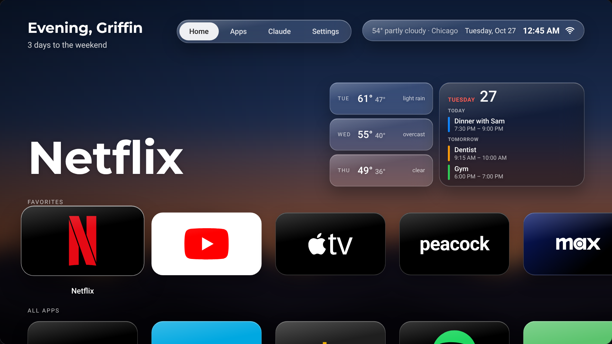

# fire-tv

Making a Fire TV faster, quieter, and running a custom home screen — all over Wi-Fi with ADB, no root, every change reversible. Built on a TCL 55S450F (Fire OS 7.7.1.7).



## Setup

**Run `./scripts/setup.sh`**, or open this folder in Claude Code and say "set up my TV". It asks for the TV, your name, weather area, local news and calendar, then installs. Full guide, prerequisites and manual steps: [SETUP.md](SETUP.md).

Your answers go in `config/home.env` (gitignored; see `config/home.example.env`). Override the TV for one run with `TV=<ip>:5555`.

## Scripts

| Script | What it does |
| --- | --- |
| `scripts/setup.sh` | Guided setup: TV, name, weather, news, calendar → `config/home.env`, then each install step |
| `scripts/backup.sh` | Snapshot packages + settings into `baseline/` (gitignored) |
| `scripts/animations.sh [scale]` | UI animation speed. `0.5` snappy, `1.0` stock |
| `scripts/debloat.sh [--dry-run] <tiers>` | Disable packages from `debloat/packages.txt` |
| `scripts/install-launcher.sh` | Build + install the home screen and turn on the home guard |
| `scripts/calendar.sh [--clear]` | Copy `config/calendars.txt` to the TV |
| `scripts/stills.sh [--clear]` | Download screensaver aerials and film stills and copy them to the TV |
| `scripts/restore.sh` | Undo everything: re-enable packages, stock animations, remove the home screen |

Tiers: `tracking`, `ads`, `extras`, and the opt-in `updates`, `screensaver`.

```sh
./scripts/backup.sh
./scripts/debloat.sh --dry-run tracking ads extras
./scripts/debloat.sh tracking ads extras
```

## Undo

`./scripts/restore.sh` puts it back to stock. Nothing is uninstalled, so a factory reset also fully restores it.

## Roadmap

- [x] ADB over Wi-Fi + baseline snapshot
- [x] Faster animations
- [x] Debloat (tracking / ads / extras) — 17 disabled; 3 protected by Fire OS
- [x] Custom launcher (Griffin Home) — `./scripts/install-launcher.sh`
- [x] Favorites, full app library with real banners, film-still backdrop, screensaver controls
- [x] Redesign: glass look, screensaver v2, Settings screen, live calendar and headlines. Design log in [`docs/redesign/`](docs/redesign/PLAN.md)
- [x] Setup for any TV and owner: [SETUP.md](SETUP.md)

## The home screen (launcher/)

A full-screen WebView app (`launcher/app/src/main/assets/index.html`) wrapped in a tiny Android shell, built without Gradle by `launcher/build.sh` (needs `openjdk@17` + `android-commandlinetools` with build-tools 34 and platform 28).

Fire OS handles the real remote's Home before any app sees it, and Android then delays other apps' activity starts by ~5s. So `HomeGuard` (an accessibility service, enabled over ADB) watches for Amazon's home and instantly covers it with a snapshot of Griffin Home, ignoring remote presses until the real screen takes over. It starts Griffin Home through an alarm, which the system starts itself and that delay lets through, so Home is back ~0.4s after the press, however many times it's pressed. The "Amazon home" tile pauses the guard (for inputs / Amazon's app library) until the next Home press. To cover it before it draws, the guard also reads the system log (`READ_LOGS`, granted by `install-launcher.sh`), where Fire OS's start of Amazon's home shows ~5ms after the Home press. Settings → Home guard turns it off entirely.

The app is named in `config/home.env` (the original is "Griffin Home"; its package stays `com.griffin.home`). The home screen shows your area's weather and a 3-day forecast from [Open-Meteo](https://open-meteo.com) (no API key).

**Home screen** (tvOS-inspired):

- **Favorites** row up top, then **All apps** (every launchable app, A–Z, with its real TV banner or icon), then **System**. Rows slide sideways and the page scrolls to keep focus in view; Back jumps to the top.
- **Hold OK** (or press ☰) on an app for options: *Add to / Remove from Favorites*, *Move* (the tile wobbles; ◂ ▸ to reorder, OK to drop), *Hide*. Favorites start as the old fixed app list and are saved on the TV.
- Behind the top section, the film stills from the screensaver crossfade every 45s (title top-right). No stills on the TV → plain dark background.
- **System → Screensaver** starts the screensaver right away (`ScreensaverActivity`, same content as the DreamService).
- **Settings** adds *Hidden apps* (bring them back) and screensaver toggles for Gargantua, aerials and film stills.

**Volume:** Fire OS keeps the volume keys to itself and always shows its own bar, so `HomeGuard` watches for that panel and covers it with `VolumeIsland`, an iPhone-style bar that fills with white to the level, speaker inside (slashed when muted).

**Screensaver:** `Gargantua` is a DreamService that renders Interstellar's black hole (WebGL ray-bent accretion disk, `assets/screensaver.html`) with a terminal readout of the date and local weather. `install-launcher.sh` sets it as the screensaver; `restore.sh` puts Amazon's back.

**Screensaver cycle:** Gargantua (3 min) → a 4K Apple aerial → 8 film stills (20s each) → another aerial → repeat. Anything not on the TV, or turned off in Settings, is skipped. The terminal also prints the next three days' forecast.

- **Aerials:** Apple TV's 4K SDR HEVC aerials (ISS night flyovers, aurora, cities, landscapes). Pick clips in `stills/aerials.txt` (`python3 scripts/fetch_aerials.py --list` shows the catalog). They play in a native VideoView under the transparent WebView, since the WebView can't decode HEVC `.mov` and Android 9 doesn't trust Apple's CDN certificate, so the Mac downloads them and pushes them.
- **Film stills:** text-free 4K backdrops for the films in `stills/films.txt`, via the TMDB API (`TMDB_API_KEY`, free). Slow zoom, crossfades, film grain and a drifting light leak. Any `.jpg` dropped into `stills/images/` is included.
- `./scripts/stills.sh` downloads whatever's missing and syncs both folders to the TV; `--clear` removes them. Media is gitignored.

## License

MIT, see [LICENSE](LICENSE). Bundled fonts (Montserrat, Roboto, JetBrains Mono) are under the SIL Open Font License. Screensaver media is downloaded to your own Mac, not included: Apple's aerials and TMDB's film stills belong to their owners.
