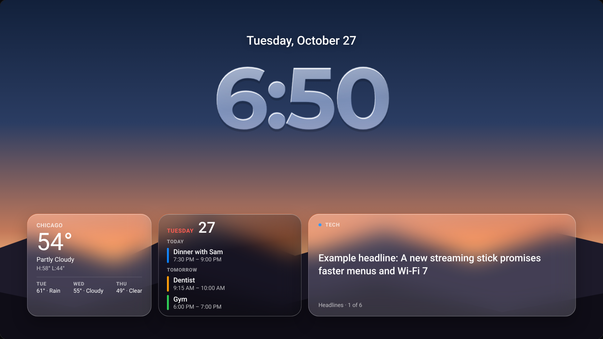
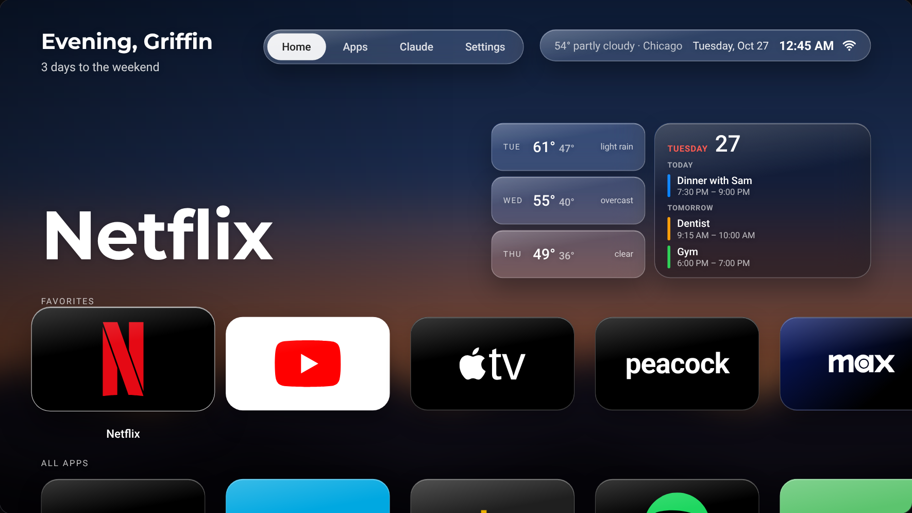
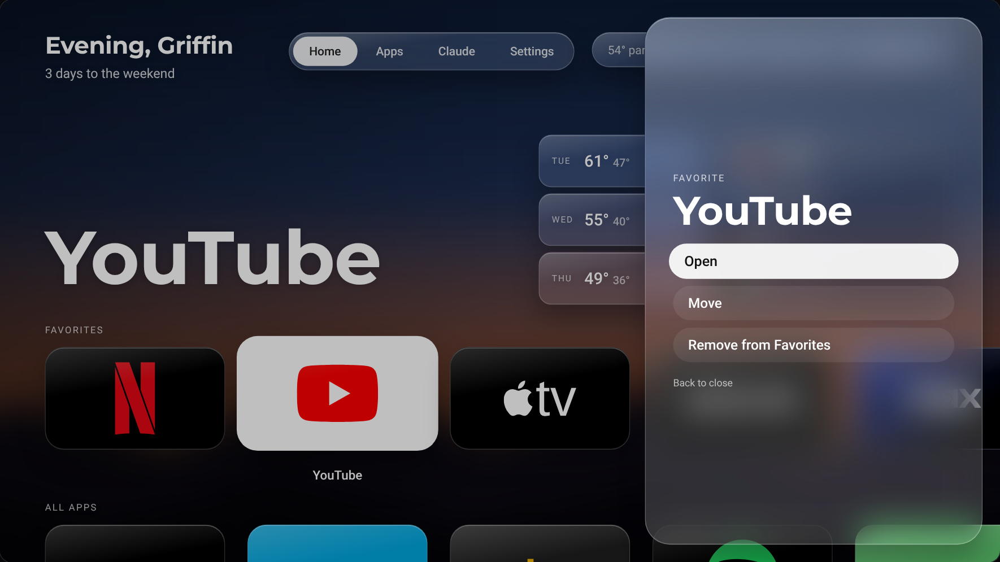
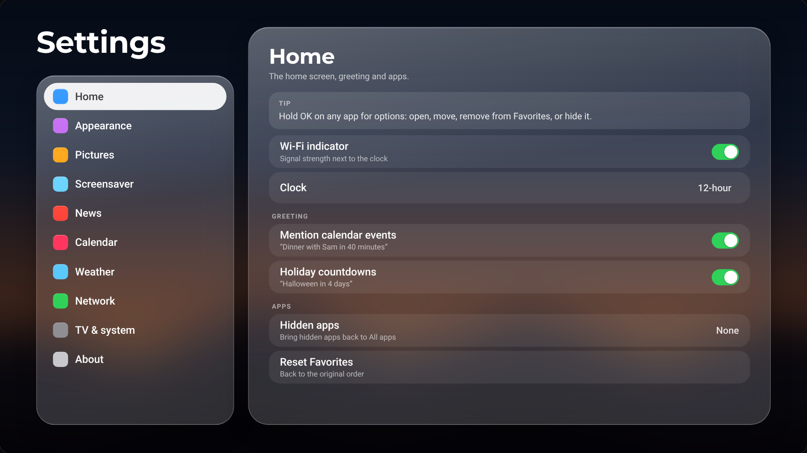

# Griffin Home redesign: plan and handoff

Planning only. Nothing here changes the TV yet. This is the brief for building the redesign on the Mac.

- **Full spec (every value, string and rule):** [`SPEC.md`](SPEC.md)
- **Build guide (step by step on the Mac):** [`BUILD.md`](BUILD.md)
- **Decision log (what was asked, decided and why):** [`DECISIONS.md`](DECISIONS.md)
- **Mockup:** [`mockup.html`](mockup.html). Open it in a browser and drive it with the arrow keys, Enter (OK), H (hold OK) and Esc (Back). It opens on the screensaver; any key wakes it to Home.
- **Live mockup (private, Griffin's account):** https://claude.ai/artifact/7urSSqupgRV34PHv268HoT
- **Screens:** [`screens/`](screens/)

| Screensaver | Home | Options | Settings |
|---|---|---|---|
|  |  |  |  |

## Decisions

| Area | Decision |
|---|---|
| Look | Apple-style "Liquid Glass": translucent panels with blur, a bright rim and a top highlight. One **Glass** setting (Frosted · Balanced · Light · Clear) moves blur, tint and rim together; text gets a soft shadow as the glass clears. |
| Fonts | **Montserrat** for headlines (greeting, app name, clock, titles) and **Roboto** for everything else. Both are free to bundle. SF Pro, Helvetica Neue, Verdana and DIN Pro can't ship on the TV (licenses). |
| Pictures | The same picture is **sharp on the screensaver** and **blurred, dimmed and slightly zoomed behind Home**, like an iPhone lock screen/home screen pair. Pictures come from a background redo Griffin will supply later. |
| Screensaver | Date and a **frosted-glass clock** (the picture shows through the digits), then three glass cards: weather, calendar, one headline at a time. Any button blurs it into Home. |
| Home: top | Two-line greeting (Montserrat hello, Roboto line about right now), tab pill, clock pill with weather, date, time and **Wi-Fi**. |
| Home: right | 3-day forecast stacked as slim rows, Apple-style **calendar** widget to its right. |
| Home: rows | Favorites → All apps → System. Bigger tiles with the apps' real icons; the focused tile lifts and grows. No "Favorite" label above the app name, and no "hold OK" hint on Home (it lives in Settings). Rows that scroll up under the greeting fade out. |
| Options | Hold OK (or ☰) on an app: Open, Move (tile wobbles, ◀ ▶ to reorder), Remove from Favorites / Add to Favorites, Hide. |
| Settings | Full tvOS-style screen: categories left, settings right, all remote-driven. See [Settings](#settings). |
| Kept from today | Every existing greeting line, Chicago weather, the home guard, debloat/restore scripts. |

## Greeting

Line 1 is a hello picked from about 45 lines: the originals plus day, weekend, season and weather lines ("Made it to Friday, Griffin", "Spooky season, Griffin", "Rainy one, Griffin"). It wraps to two lines and is never truncated.

Line 2 is one true thing about right now, picked at random from what applies:

- Weather now, and "Light rain tomorrow. Good couch weather." when it applies
- Sunset ("Sunset at 5:52. Golden hour." / "Dark since 5:52. Prime time.")
- Weekend countdown, Friday night, Saturday, Sunday lines
- Late night ("It's 11:50 PM. One more, then bed?")
- Next calendar event: "Dinner with Sam at 7:30 PM", "… in 40 minutes", or "Dentist at 9:15 AM tomorrow. Maybe just one episode." late at night
- Holiday countdowns within 3 weeks (Halloween, Thanksgiving, Christmas, New Year's Eve, Valentine's Day, the Fourth). These are weighted double.

Every line, condition and weight is in [SPEC.md §11](SPEC.md#11-greeting).

## Settings

| Category | Settings |
|---|---|
| Home | Tip card (hold OK for options) · Wi-Fi indicator · 12/24-hour clock · greeting mentions calendar events · holiday countdowns · hidden apps · reset Favorites |
| Appearance | Glass · Home blur · headline font · text font · text size |
| Pictures | Show (your pictures / film stills / Apple aerials / all) · change every · shuffle · add pictures (from the Mac) |
| Screensaver | Start now · start after · clock style (glass / solid) · show weather / calendar / headlines · Gargantua as an optional scene |
| News | Tech · AI · Sci-fi shows · Gaming · Steam · Chicago · how often headlines change |
| Calendar | Google Calendar connection · show on Home · each calendar on/off |
| Weather | Location · °F/°C |
| Network | Wi-Fi name · signal · Fire OS network settings |
| TV & system | Home guard · animation speed · ads & tracking · TV settings · Amazon home · restore everything |
| About | Griffin Home version · Fire OS · TV model |

Keys: up/down moves, right/OK enters a category, OK flips a switch or runs an action, ◀ ▶ changes a choice, Back goes up a level.

## Specs

Sizes are on the 1600×900 design canvas, which scales to the TV (×1.2 on 1080p).

### Glass

| Setting | Blur | Tint (white) | Rim | Text shadow |
|---|---|---|---|---|
| Frosted | 40px | 24% | 36% | 0% |
| Balanced (default) | 27px | 17% | 30% | 19% |
| Light | 13px | 9% | 25% | 39% |
| Clear | 2px | 3% | 20% | 55% |

- Every glass piece: `backdrop-filter: blur(…) saturate(1.6)`, a 1px white rim, an inset top highlight, a soft drop shadow, and a sheen gradient across the top.
- Dark glass (calendar, screensaver cards) adds 30–34% black to the tint so text stays readable over bright pictures.
- **Home blur** (picture behind Home): Light 12px · Medium 28px (default) · Heavy 44px, plus brightness 72%, saturation 125% and a 1.08× zoom. Settings blurs a further 14px and dims to 58%.

### Type

| Use | Font | Size / weight |
|---|---|---|
| Greeting line 1 | Montserrat | 38px / 700, wraps to 2 lines, never truncated |
| Greeting line 2 | Roboto | 21px |
| Focused app name (hero) | Montserrat | 120px / 700 |
| Screensaver clock | Montserrat | 230px / 700, letter-spacing −3.5% |
| Screensaver date | Roboto | 32px / 500 |
| Settings title / category title | Montserrat | 60px / 42px |
| Everything else | Roboto | 15–22px |

Large text size (Settings → Appearance) bumps the greeting line 2, clock pill, calendar and Settings rows by about 15%.

Fonts considered and dropped:
- **Instrument Serif/Sans:** the current launcher font; it reads as a generic AI-made design.
- **Host Grotesk, Schibsted Grotesk, Hanken Grotesk, Funnel, Red Hat:** shown as headline options.
- **Inter, Open Sans, Fira Sans:** shown as UI options.
- **SF Pro, Helvetica Neue, Verdana, DIN Pro:** licenses don't allow bundling them in the app. Barlow is the free DIN look-alike.

### Home

- **Top bar** (top 52px, sides 72px):
  - greeting block on the left
  - tab pill: Home · Apps · Claude · Settings
  - clock pill: weather · date · time · Wi-Fi
- **Wi-Fi:** three arcs and a dot. Strong lights all three, good two, weak one; not connected shows dimmed arcs with a slash. The setting can hide it.
- **Hero:** anchored to the bottom (412px up), so the widgets never overlap the rows. It shows the focused app's name; the small label above it appears only for All apps ("App"), System ("System") and move mode ("Moving").
- **Forecast:** three slim glass rows (270×~60): day · high/low · conditions.
- **Calendar widget** (380px, dark glass, Apple Up Next style):
  - red weekday and a big date
  - the next 3 events grouped under Today / Tomorrow / weekday
  - a 5px bar in the calendar's color, title, and time range, or "All day"
- **Rows:** Favorites, All apps, System.
  - Tiles are 288×164 with a 30px radius and 36px gap.
  - Logos are 116px; wordmark fallback is 50px bold, or 38px for names longer than 8 characters.
  - Focus: lift 8px and scale 1.12, a stronger shadow, a one-time light sweep, and the name below the tile.
  - Rows slide sideways to keep focus in the safe area. The page scrolls 284px per row, and rows above the previous one fade out.
- **Options panel:** right side, 540px glass, 40px radius. Pill-shaped options with a white focused pill. Move mode wobbles the tile ±1.5°.

### Screensaver

- **Date** (top 92px) and **frosted clock** (top 126px), centered. No AM/PM.
- **How the frosted clock is drawn:**
  - The time is painted into two canvas masks in the headline font.
  - Fill layer: `backdrop-filter: blur(glass × 0.8 + 6px) saturate(1.8) brightness(1.18)` plus a white gradient.
  - Highlight layer: the glyphs minus themselves shifted 3px down, which leaves a bright top edge.
  - Shadow layer: soft, 16% black, 22px blur.
  - Outlining the glyphs was tried and dropped: overlapping contours inside the font leave seams.
  - Redraws when the minute or the headline font changes.
  - Fallback: solid white digits, also used when Settings → Clock style is Solid.
- **Cards row** (bottom 60px, sides 72px):
  - weather (330px): city, temperature now, conditions, high/low, 3 days
  - calendar (380px)
  - headlines (fills the rest): topic dot and name, one headline, "Headlines · n of m"
  - Headlines rotate every 8s with a fade.
- **Topic colors:** Tech #0A84FF · AI #BF5AF2 · Sci-fi shows #64D2FF · Gaming #30D158 · Steam #C7D5E0 · Chicago #FF453A.
- **Calendar colors:** Personal #0A84FF · Health #30D158 · Errands #FF9F0A · Sports #64D2FF · Holidays #BF5AF2.
- **Wake:** the cards and clock fade up and away over ~400–600ms while the picture blurs over ~900ms.

### Settings screen

- Category panel on the left: 392px glass, a colored rounded-square icon per category. Detail panel on the right.
- Rows: 62px minimum height, label plus optional subtitle, value on the right. Value types:
  - **Toggle:** iOS-style switch, green when on.
  - **Choice:** ‹ value ›, changed with ◀ ▶ or OK.
  - **Action:** a value or ›.
- The focused row is white with dark text. A toast appears at the bottom for actions handled on the Mac.
- Category icon colors: Home #0A84FF · Appearance #BF5AF2 · Pictures #FF9F0A · Screensaver #64D2FF · News #FF453A · Calendar #FF375F · Weather #5AC8FA · Network #30D158 · TV & system #8E8E93 · About #C7C7CC.

## How each piece gets built

All of this extends the existing app in `launcher/`: the WebView pages in `assets/` plus the small Java shell. The mockup's HTML/CSS/JS is written to carry over to `index.html` and `screensaver.html`.

| Piece | How |
|---|---|
| Glass | CSS `backdrop-filter`. **Test first:** the TV's WebView must support it and stay smooth. Fallback: solid tinted panels, solid clock. |
| Frosted clock | The time is drawn into canvas masks (fill and top-edge highlight) over a `backdrop-filter` layer. Same support check as above. |
| Screensaver → Home blur | Today Home (`MainActivity`) and the screensaver (`Gargantua` DreamService) are separate windows. Either blur the current picture behind Home in the WebView (simple), or show the screensaver inside `MainActivity` so the transition is one continuous animation (closer to the iPhone). Decide after the WebView test. |
| App icons | Each installed app's own banner or icon, read from Android's PackageManager and cached as PNGs. `main` already has this from PR #1 (`MainActivity.icon()`), plus the full app list, Favorites storage, hold-OK detection and `ScreensaverActivity`. Build on it. |
| Fonts | Bundle Montserrat and Roboto as `.woff2` in `assets/fonts/` (both are open licenses). |
| Weather | Existing Open-Meteo call in `weather.js`, already extended to a 3-day forecast (PR #1, in `main`). |
| Calendar | Start with Google Calendar's **secret iCal address**, kept in a gitignored config file on the Mac and pushed by the install script. The TV fetches it every 15 minutes. Later option: Google sign-in on the TV with a code entered on the phone. Read-only. |
| News | Free RSS feeds, one headline at a time. Candidates (confirm each feed): Tech: The Verge, Ars Technica · AI: The Verge AI, MIT Technology Review · Sci-fi shows: Gizmodo, Den of Geek · Gaming: Polygon, IGN · Chicago: Block Club Chicago, Sun-Times, WBEZ. |
| Steam | Steam store data: wishlist sales (needs Griffin's public Steam profile), top sellers, new releases. |
| Wi-Fi | `WifiManager` signal level, with the `ACCESS_WIFI_STATE` permission (no ADB grant needed). Show a cable icon on Ethernet. |
| Settings | Saved in the app; the screensaver reads the same values. Home guard and animation speed reuse today's bridges. |

## Build order

1. **WebView check on the TV:** WebView version, `backdrop-filter` support, and frame rate with 3–4 glass panels over a 4K picture.
2. **Fonts and glass:** bundle the fonts and restyle the existing Home with the glass panels and Glass setting.
3. **Home layout:** rows, real icons, options panel and Favorites (build on PR #1's code in `main`); greeting v2; forecast and calendar widgets; Wi-Fi.
4. **Screensaver v2:** picture, frosted clock, weather, calendar and headline cards; blur into Home.
5. **Settings screen.**
6. **Data:** Google Calendar (iCal address), news feeds, Steam.
7. **Pictures:** once the background redo is ready.

## Tried and dropped

- **Tilt/parallax focus** (tile tilts toward the pointer, logo floats, moving glare): removed. Focus is just lift and scale.
- **Hover to focus** in the mockup: removed, because rows sliding under a resting pointer stole focus.
- **"Favorite" label** above the app name: removed (being in Favorites is obvious).
- **"Hold OK for options"** under the app name: moved to a Tip card in Settings → Home.
- **Film and aerial stand-in wallpapers** (colored gradients named after `stills/films.txt` and `stills/aerials.txt`): removed until the background redo.
- **Instrument Serif** and the other fonts listed under [Type](#type).

## Open questions

1. **Tab pill** (Home · Apps · Claude · Settings): make these real sections, or keep one home screen?
2. **App tiles:** the app's own TV banner (wide artwork), or its logo centered on the brand color like the mockup? Griffin wanted the real logos, and big. Banners carry their own artwork and sizing.
3. **Gargantua and Apple aerials:** keep them as optional scenes after the background redo?
4. **Default Glass setting:** Balanced is the default. Confirm on the real TV.
~~5. **PR #1:**~~ Resolved: Griffin merged PR #1 into `main` on 2026-10-27, so its code is the starting point ([BUILD 2.4](BUILD.md#24-working-code-already-in-main-from-pr-1)).

## Parked (roadmap)

### Backgrounds and scenes
Griffin is supplying pictures and scenes for a full redo. When they land:
- add them to Settings → Pictures
- check text contrast on each one
- decide Gargantua and the aerials

The existing lists in `stills/films.txt` and `stills/aerials.txt` stay until then.

### Curated recommendations
Picks tailored to what Griffin watches. They depend on the next item.

### Recently watched / Up next
- **Apps used most and most recently:** Android's usage stats. Needs the usage-access permission, granted once over ADB:
  ```sh
  adb shell appops set com.griffin.home GET_USAGE_STATS allow
  ```
- **Titles:** apps that report what's playing (often Netflix, YouTube, Plex, Spotify) can be read through a notification-listener permission. Griffin Home would keep its own history on the TV going forward.
- **First test:** play something in each app and run `adb shell dumpsys media_session` to see which apps report titles.
- **Not possible:** each app's own watch history (it's on their servers) and Amazon's private Recents row.
- **Privacy:** the history stays on the TV, with a Settings switch to turn it off and clear it.

### Claude on the TV with voice

| Option | How it works | Effort | Catch |
|---|---|---|---|
| A. Phone as mic and keyboard (recommended first) | claude.ai/code in Silk on the TV; talk into the Claude app on the phone, same session. A "Claude" tile opens Silk. | Small | The phone does the input |
| B. Alexa dictation | Hold the remote's mic on a text box | Small, if it works | Unclear Fire OS supports it; test first |
| C. Griffin Home's own voice input | Bluetooth/USB mic → speech-to-text service | Medium | Needs a mic and an API key |

- The remote's mic button belongs to Alexa, and Fire OS has no Google speech recognition.
- Code edits still need a rebuild and reinstall from the Mac (`./scripts/install-launcher.sh`).

## Notes

- Example data in the mockup: the calendar events, headlines, Wi-Fi network name and Google account are made up. Weather is a sample, not live.
- App logos in the mockup come from [Simple Icons](https://simpleicons.org) (CC0). The TV build uses each app's own icon instead.
